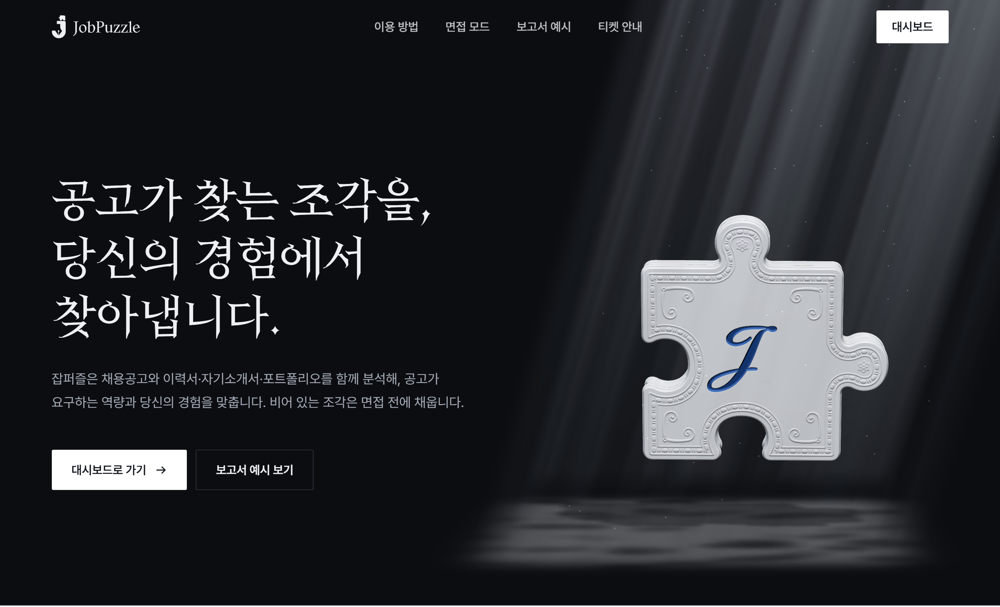
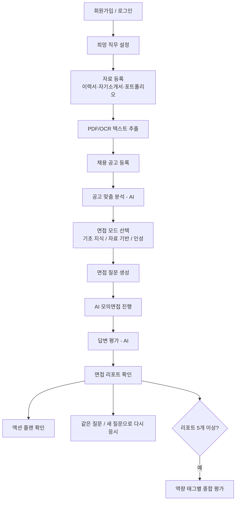

# JobPuzzle (잡퍼즐)

채용 공고와 지원자의 자료(이력서·자기소개서·포트폴리오)를 함께 분석해, 공고가 요구하는 역량과 경험을 맞추고 맞춤 모의면접까지 제공하는 AI 면접 준비 서비스입니다.



## 저장소 안내

4인 팀 프로젝트로 개발한 서비스를 이어서 개인적으로 개선하고 있는 저장소입니다.

- 팀 프로젝트 원본: https://github.com/yjuny03/jobpuzzle

## 프로젝트 소개

채용 공고와 지원자가 등록한 자료를 AI로 함께 분석해, 공고가 요구하는 역량 중 지원자 경험으로 아직 채워지지 않은 부분을 찾아내고, 그 부분을 보완하는 맞춤 면접 질문과 모의면접, 리포트를 제공합니다.

| 항목 | 내용 |
| --- | --- |
| 기간 | 2026.07 ~ 2026.08 |
| 인원 | 4명 |
| 구분 | 대우능력개발원 AI 에이전트 클라우드·보안코딩 개발자 양성 과정 팀 프로젝트 |

## 주요 기능

- **자료 등록·추출**: 이력서·자기소개서·포트폴리오를 등록하면 PDF·OCR로 텍스트를 추출합니다.
- **공고 맞춤 분석**: 등록한 채용 공고와 지원자 자료를 AI로 분석해 공고가 요구하는 역량과 지원자 경험을 맞춰 봅니다.
- **맞춤 면접 질문**: 면접을 기초 지식·자료 기반·인성 세 모드로 나눠 질문을 준비합니다. 기초 지식·자료 기반은 분석 결과를 바탕으로 AI가 질문을 생성하고, 인성은 관리자가 등록해 둔 질문 중 지원자의 경력 수준에 맞는 질문을 고릅니다.
- **AI 모의면접**: 생성된 질문으로 실제 면접처럼 답변을 작성하고 제출합니다.
- **최종 리포트**: 제출한 답변을 AI가 평가해 점수와 역량 태그별 평가를 보여주고, 리포트 5개 이상이 쌓이면 역량 태그별 강점·아쉬운 점을 모은 종합 평가도 제공합니다.

- **액션 플랜**: 분석 결과를 바탕으로 지원자가 채워야 할 경험·준비 항목을 정리해 보여줍니다.
- **회원·관리자**: 회원가입·로그인(카카오·구글 소셜 로그인 포함), 면접 이용권 구매, 관리자용 직무 카테고리·가이드 문서·역량 태그 관리 화면을 제공합니다.

## 서비스 흐름



## 팀원 및 담당

| 이름 | GitHub | 담당 |
| ---- | --- | --- |
| 홍은표 | [@seolgi100](https://github.com/seolgi100) | 자료 등록·텍스트 추출(PDF, OCR), 최종 리포트 AI, 관리자, 직무 카테고리, API 정의서·클래스 정의서 |
| 이명균 | [@meongkune](https://github.com/meongkune) | 모의면접 세션 진행, 답변 평가 AI, 심화 질문·재답변 처리, 리포트 확정 |
| 유준영 | [@yjuny03](https://github.com/yjuny03) | 공고·지원자 자료 맞춤 분석 AI, 가이드 문서 RAG(Qdrant), AI 호출 로그, 요구사항 정의서·기능 정의서 |
| 김지혜 | [@gupopu](https://github.com/gupopu) | 회원가입·로그인, 카카오·구글 소셜 로그인, Spring Security 설정, 설정 화면 |

각자 담당한 기능의 화면과 서버를 함께 개발했습니다. AI 기능을 맡은 3명(홍은표, 이명균, 유준영)은 각자 담당 파트의 프롬프트와 응답 검증·재시도를 직접 설계하고 관리했습니다.

## 개인 개선 내역

팀 프로젝트 종료 이후(2026.09~) 혼자 이어서 개선한 내용입니다. 모두 반영 완료되었습니다.

- 면접 이용권 구매·토스페이먼츠 결제 기능 추가
- 답변 평가를 v2로 교체: 점수 계산 방식을 바꾸고, 기존 약점 보완 모드를 역량 태그 기반 평가로 대체
- 면접 질문 생성을 기초 지식·자료 기반·인성 세 모드로 분리: 기초 지식·자료 기반은 분석 결과로 AI가 질문을 생성하고, 인성은 관리자가 등록한 질문 중 경력 수준에 맞게 무작위로 고름
- 직무별 역량 태그·인성 질문을 관리자가 등록·관리하는 기능 추가
- 끝난 면접을 같은 질문 또는 새 질문으로 다시 응시하는 다회차 기능 추가
- 면접 리포트를 v2 평가 기준으로 저장하고, 리포트 5개 이상 누적 시 역량 태그별 강점·아쉬운 점을 보여주는 종합 평가 추가
- 면접 준비 화면을 공고 중심 퍼즐판으로 재구성, 질문 고르기 없이 바로 면접 시작·면접 중 건너뛰기 추가
- 면접 중 작성하던 답변 임시 저장, 빈 제출·남은 기회 안내 추가
- 서비스 전체 화면(공통 바탕·메뉴·대시보드·면접실·랜딩, 제목 글꼴)을 새 디자인 시안으로 재구성
- 시연용 시뮬레이션 계정 추가 (AI 호출 없이 저장된 결과를 다시 보여줌)
- 분석 실행을 백그라운드 스레드풀에서 비동기로 처리하도록 개선
- 자동 로그인 서명 키를 환경 변수(REMEMBER_ME_KEY)로 분리하는 등 보안 설정 정리
- 팀 프로젝트 때 쓰던 v1 면접 모드·약점 보완·리포트 화면·API·CSS 등 더 쓰지 않는 코드 정리
- stub 모드 전체 흐름 테스트, AI 호출 실패·시간 초과 처리 테스트 등 테스트 보강

## 기술 스택

| 구분 | 기술 |
| --- | --- |
| 언어 / 프레임워크 | Java 21, Spring Boot 3.5 |
| 데이터 접근 | Spring Data JPA |
| 보안 / 인증 | Spring Security, OAuth2 Client (카카오·구글 소셜 로그인) |
| 데이터베이스 | MariaDB |
| 벡터 데이터베이스 | Qdrant |
| 생성 AI | Claude API (Anthropic) |
| OCR | Google Cloud Vision |
| 임베딩 | OpenAI Embedding |
| 문서 처리 | Apache PDFBox |
| 템플릿 엔진 | Thymeleaf |
| 결제 | 토스페이먼츠 *(개인 개선)* |
| 테스트 | JUnit5, Mockito, Testcontainers |

## 프로젝트 구조

```
com.example.jobpuzzle
├─ admin          관리자 화면·API (가이드, AI 호출 로그, 직무 카테고리, 회원 관리)
├─ ai             AI 호출 클라이언트(Anthropic)·프롬프트·호출 로그·응답 검증
├─ analysis       공고·지원자 자료 분석, RAG 검색, 분석 실행 관리
├─ competency     직무별 역량 태그·인성 질문 관리
├─ document       이력서·자기소개서·포트폴리오 등록, 텍스트 추출(PDF/OCR)
├─ evaluation     답변 평가, 면접 리포트, 사용자 종합 평가
├─ global         공통 설정(비동기, 보안, 에러 코드 등), 초기 데이터 적재
├─ guide          직무별 가이드 문서 RAG 컨텍스트
├─ interview      면접 세션 진행, 질문 생성, 다회차 재응시
├─ jobcategory    직무 카테고리
├─ jobposting     채용 공고 등록·저장
├─ simulation     시연용 시뮬레이션 계정 (저장된 결과 재생)
├─ ticket         면접 이용권·토스페이먼츠 결제 *(개인 개선)*
└─ user           회원가입·로그인·소셜 로그인·설정
```

## 실행 방법

### 준비물

- Java 21
- MariaDB
- Docker (Qdrant 실행용, 선택 — RAG를 실제로 쓰지 않으면 없어도 됩니다)

### 실행

```bash
./gradlew bootRun
```

접속 주소: http://localhost:8080/jobpuzzle

기본값은 AI 생성(`AI_MODE=stub`)과 RAG(`RAG_MODE=fake`) 모두 Mock 모드이므로, 외부 API 키 없이 DB 연결만으로 실행할 수 있습니다.

### 주요 환경 변수

`src/main/resources/application.yaml` 기준이며, 값을 지정하지 않으면 기본값이 적용됩니다.

| 변수 | 설명 | 기본값 |
| --- | --- | --- |
| `DB_URL` | DB 접속 주소 | `jdbc:mariadb://localhost:3306/jobpuzzle` |
| `DB_USERNAME` | DB 사용자명 | `root` |
| `DB_PASSWORD` | DB 비밀번호 | (없음) |
| `AI_MODE` | AI 생성 모드 (`stub`\|`live`) | `stub` |
| `ANTHROPIC_API_KEY` | Claude API 키 (`live`일 때 필요) | (없음) |
| `RAG_MODE` | RAG 모드 (`fake`\|`real`) | `fake` |
| `OPENAI_API_KEY` | 임베딩용 OpenAI API 키 (`real`일 때 필요) | (없음) |
| `QDRANT_URL` | Qdrant 접속 주소 (`real`일 때 필요) | `http://localhost:6333` |
| `KAKAO_CLIENT_ID` / `KAKAO_CLIENT_SECRET` | 카카오 소셜 로그인 | (없음) |
| `GOOGLE_CLIENT_ID` / `GOOGLE_CLIENT_SECRET` | 구글 소셜 로그인 | (없음) |
| `MAIL_USERNAME` / `MAIL_PASSWORD` | 이메일 인증·비밀번호 재설정 발신 계정 | (없음) |
| `TOSS_CLIENT_KEY` / `TOSS_SECRET_KEY` | 토스페이먼츠 결제 | (없음) |
| `REMEMBER_ME_KEY` | 자동 로그인 토큰 서명 키 | 실행마다 무작위 값 |
| `SIMULATION_LOGIN_IDS` | 시연용 시뮬레이션 계정 아이디(쉼표로 구분) | (없음) |
